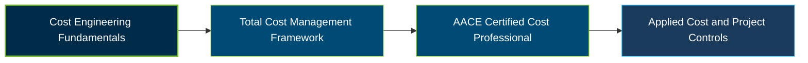

# AACE International CCP Certification Exam Guide

 

A dedicated study guide and technical reference repository for candidates preparing for the **AACE International Certified Cost Professional (CCP) Certification Exam**, covering Total Cost Management, cost estimating, project controls, performance analysis, risk, scheduling, and professional communication.

---

## Exam Overview

The AACE International Certified Cost Professional (CCP) certification validates advanced knowledge and technical expertise in applying Total Cost Management (TCM) principles to the planning, execution, and management of projects and programs.

- **Exam Format**: Computer-based, closed-book examination with 119 multiple-choice questions and one written memo assessing communication competency.
- **Target Audience**: Experienced cost engineers, cost estimators, project controls professionals, project managers, and other practitioners responsible for cost management.
- **Prerequisites**: Eight years of industry-related experience, or four years of industry-related experience plus a four-year industry-related degree. Candidates must also meet AACE's current application and ethics requirements.

---

## Core Exam Domains & Knowledge Areas

### 1. Managing Project Costs

- Research historical cost data, develop estimates, and validate estimate assumptions and supporting information.
- Establish budgets, cost baselines, cost systems, and methods for tracking project expenditures.
- Analyze cost drivers, changes, resources, forecasts, and estimate-at-completion updates.

### 2. Interface with Other Disciplines

- Coordinate cost management with project management, engineering, procurement, contracts, and scheduling.
- Evaluate how scope, quantities, contracts, and project changes affect cost and schedule outcomes.
- Support management decisions, corrective actions, and communication across project stakeholders.

### 3. Create Reports and Documentation

- Prepare cost reports, forecasts, and project control documentation.
- Interpret cost and schedule performance indicators, including CPI and SPI.
- Communicate project status, variances, and recommendations through clear documentation.

### 4. Conduct Performance Measurement/Analysis

- Establish performance measurement baselines and evaluate actual progress against planned performance.
- Apply earned value management and analyze cost, schedule, productivity, and performance variances.
- Evaluate trends, profitability, and corrective actions to support project control decisions.

### 5. Support/Inform the Scheduling Process

- Understand integrated project schedules, activity relationships, and schedule performance.
- Assess cost implications associated with schedule changes, delays, and acceleration.
- Coordinate scheduling information with cost forecasts and project control activities.

### 6. Inform the Risk Management Process

- Identify cost-related risks, uncertainties, opportunities, and potential project impacts.
- Apply qualitative and quantitative risk analysis and contingency assessment concepts.
- Use risk information to support forecasts, decision-making, and cost management plans.

### 7. Communication Competency

- Interpret the examination scenario and identify the main issue requiring a professional response.
- Organize a concise memo with relevant facts, analysis, implications, and recommendations.
- Communicate technical conclusions clearly and professionally to project stakeholders.

---

## Certification Path

The following is a suggested learning progression, not an official prerequisite or mandatory certification pathway.

---

## Recommended Practice & Study Resources

Prepare using AACE's current certification guidance, supplementary practice materials, and technical references for cost engineering and Total Cost Management.

- **CertsGate**: Visit the [AACE International CCP certification preparation page](https://certsgate.com/exams/aace-international/ccp) for supplementary study materials and practice questions covering Certified Cost Professional exam preparation.
- **AACE Total Cost Management Framework**: Study the [official TCM Framework](https://web.aacei.org/resources/tcm) to strengthen understanding of cost estimating, planning, scheduling, performance measurement, and project cost control.
